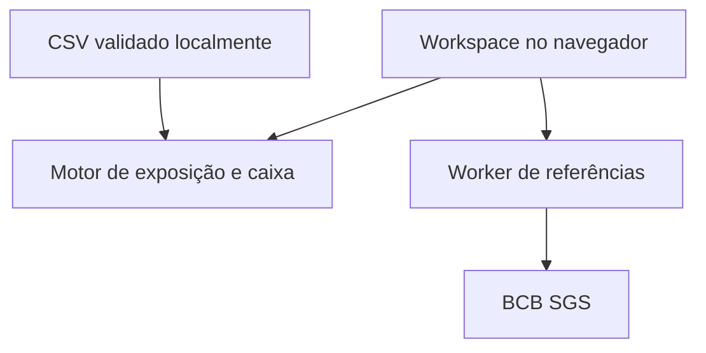

# RiskLab Trade

Um workspace de tesouraria para investigar como o câmbio altera o custo e o caixa de uma importadora brasileira. Parte de uma obrigação identificável — fornecedor, moeda, orçamento, vencimento e parcela protegida — em vez de indicadores financeiros sem contexto operacional.

**Demonstração:** https://risklab-erivan.citrusjoy10.chatgpt.site (acesso público).

A Aurora Componentes, seus fornecedores e fluxos são fictícios. As referências cambiais são séries diárias BCB/SGS, identificadas por data e limitadas à data-base da demonstração. Não há execução de pagamentos, negociação ou recomendação de investimento.

## Executar

Node.js 24, sem dependências JavaScript de runtime:

```sh
npm run build
npm test
npm run dev -- --port 4173
```

Abra `http://localhost:4173`. Não abra o HTML por duplo clique. O build gera o Worker; alterações no backend requerem novo build e reinício do servidor de desenvolvimento.

## Fluxo de análise

1. Comece na Sala de análise: combine alta cambial, atraso e redução dos recebimentos. A matriz cruza 20 cenários e mostra o aporte mínimo para evitar saldos diários negativos.
2. Confira a decomposição sequencial do estresse e exporte a memória de cálculo JSON com entradas, referências e ledger diário.
3. Confira compromissos em aberto, desvio do orçamento e parcela descoberta.
4. Investigue vencimentos e o saldo acumulado de caixa em 30, 60 ou 90 dias.
5. Abra uma operação para conferir as premissas e editar sua proteção, taxa fixa ou situação.
6. Aplique choques independentes por moeda e compare custos por vencimento.
7. Registre cenários localmente ou exporte a carteira em CSV.

A importação valida até 500 operações antes de substituir qualquer dado. Caixa inicial e recebimentos são premissas separadas, editáveis na interface. Operações marcadas como pagas não entram na projeção.

## Arquitetura



| Componente | Responsabilidade |
| --- | --- |
| `web/treasury-engine.mjs` | Estresse combinado, aporte mínimo, reconciliação e concentração por contraparte |
| `web/treasury-view.mjs` | Sala de análise, superfície interativa de sensibilidade e relatório reproduzível |
| `web/trade-engine.mjs` | Validação de operações, conversão, centavos, maturidades e conservação do caixa |
| `web/trade-csv.mjs` | Parsing CSV, contrato de colunas e exportação com proteção contra fórmulas |
| `web/trade.mjs` | Estado do workspace, telas, detalhe de operação e persistência local |
| `web/market-data.mjs` | Contrato de referências, datas válidas, timeout e validação antes da troca |
| `worker/server.mjs` | Proxy de três séries fixas do BCB, fallback datado e cache público em memória |
| `analysis/` | Pesquisa Python/SQL com validação temporal e referências independentes |

A versão de pesquisa continua em `/research.html`. Consulte [docs/RESEARCH.md](docs/RESEARCH.md) para o experimento quantitativo e o recorte histórico da Suzano.

## O que os cálculos afirmam

- O principal protegido usa a taxa fixa **informada**; o restante recebe o choque sobre a referência.
- Custos locais são estimativas inseridas, sem motor tributário implícito.
- O arredondamento ocorre em centavos por operação, antes da agregação.
- A projeção soma entradas e saídas por data. Vencidos são alocados na data-base e fluxos fora do horizonte são excluídos da curva, mas continuam no total da carteira.
- A curva é uma projeção determinística em degraus. Não é previsão de câmbio nem intervalo probabilístico.
- Proteção não precifica NDF, opções, spreads, margem, contraparte ou juros. A interface não inventa custos ou retornos de contratos.

## Dados, privacidade e limites

O CSV e os valores de operações são processados no navegador. O servidor recebe consultas de referências públicas. A conferência opcional no motor Java envia somente os parâmetros da operação escolhida (moeda, valor, referência, cobertura, taxa fixa, custo local e choque), por um proxy para a API de demonstração na Render; não envia o nome do fornecedor ou a carteira inteira. O workspace, cenários e uma trilha local de até 25 mudanças ficam no `localStorage`, sem sincronização entre dispositivos ou garantia de auditoria regulatória.

A demonstração tem data-base fixa em 27/10/2026. A atualização consulta a fonte, mas não usa preços posteriores à data-base; um snapshot é explicitamente identificado. Atribuição e licença dos dados BCB: [analysis/DATA_LICENSE.md](analysis/DATA_LICENSE.md).

## Verificação

```sh
npm test
npm run build
npm run validate
```

Os 64 testes JavaScript verificam estresse combinado, aporte intermediário com saldo final positivo, recebimentos anteriores à data-base, atribuição sequencial e reconciliação, além de proteção parcial/completa, exclusão de pagos, conservação de centavos e caixa, vencidos, corte de horizonte, pagamentos e recebimentos na mesma data, rejeição de CSV inválido e escape de fórmulas. A pesquisa mantém testes de ausência de vazamento temporal e comparação com a implementação Python.

Detalhes de decisões e limitações: [docs/DECISIONS.md](docs/DECISIONS.md). Código sob licença MIT.

## Editorial e ambiente de operações

A página principal (também em `/editorial.html`) apresenta a narrativa em quatro atos: situação, causas, hipóteses de proteção e método. O slider altera somente USD de 0 a 20%; EUR e GBP ficam constantes. A carteira e o snapshot são fixos, sem ler o workspace salvo. A tabela de proteção simula fixação USD a 0%, 50% e 100% na referência do snapshot, sem precificar um hedge contratável.

O HTML é autossuficiente: conteúdo, SVGs, dados e motor estão embutidos, com estado inicial visível mesmo sem JavaScript. O build o gera a partir de `design/editorial.html`, `design/editorial-model.mjs` e do motor compartilhado. A imagem Open Graph é um PNG de 1200 × 627, construído com a mesma projeção de demonstração. O editorial abre em tema escuro por padrão; o botão de tema salva a preferência neste navegador. O ambiente completo de operações fica em `/operations.html`.
