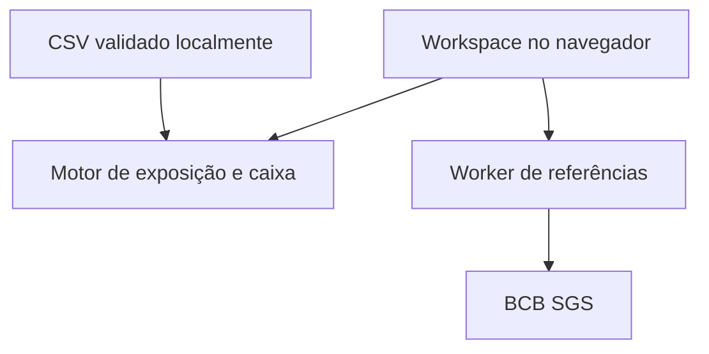

# RiskLab Trade

Um workspace de tesouraria para investigar como o câmbio altera o custo e o caixa de uma importadora brasileira. Parte de uma obrigação identificável — fornecedor, moeda, orçamento, vencimento e parcela protegida — em vez de indicadores financeiros sem contexto operacional.

**Demonstração:** https://risklab-trade-erivan.onrender.com (acesso público).

A Aurora Componentes, seus fornecedores e fluxos são fictícios. As referências cambiais são séries diárias BCB/SGS, identificadas por data e limitadas à data-base da demonstração. Não há execução de pagamentos, negociação ou recomendação de investimento.

## Executar

Node.js 24, sem dependências JavaScript de runtime:

```sh
npm run build
npm test
npm run dev -- --port 4173
```

Abra `http://localhost:4173`. Não abra o HTML por duplo clique. O build gera o Worker; alterações no backend requerem novo build e reinício do servidor de desenvolvimento.

## Fluxo de análise

1. Comece na Sala de análise: combine alta cambial, atraso e redução dos recebimentos. A matriz cruza 20 cenários e mostra o aporte mínimo para evitar saldos diários negativos.
2. Confira a decomposição sequencial do estresse e exporte a memória de cálculo JSON com entradas, referências e ledger diário.
3. Confira compromissos em aberto, desvio do orçamento e parcela descoberta.
4. Investigue vencimentos e o saldo acumulado de caixa em 30, 60 ou 90 dias.
5. Abra uma operação para conferir as premissas e editar sua proteção, taxa fixa ou situação.
6. Aplique choques independentes por moeda e compare custos por vencimento.
7. Registre cenários localmente ou exporte a carteira em CSV.

A importação valida até 500 operações antes de substituir qualquer dado. Caixa inicial e recebimentos são premissas separadas, editáveis na interface. Operações marcadas como pagas não entram na projeção.

## Arquitetura



| Componente | Responsabilidade |
| --- | --- |
| `web/treasury-engine.mjs` | Estresse combinado, aporte mínimo, reconciliação e concentração por contraparte |
| `web/treasury-view.mjs` | Sala de análise, superfície interativa de sensibilidade e relatório reproduzível |
| `web/trade-engine.mjs` | Validação de operações, conversão, centavos, maturidades e conservação do caixa |
| `web/trade-csv.mjs` | Parsing CSV, contrato de colunas e exportação com proteção contra fórmulas |
| `web/trade.mjs` | Estado do workspace, telas, detalhe de operação e persistência local |
| `web/market-data.mjs` | Contrato de referências, datas válidas, timeout e validação antes da troca |
| `worker/server.mjs` | Proxy de três séries fixas do BCB, fallback datado e cache público em memória |
| `analysis/` | Pesquisa Python/SQL com validação temporal e referências independentes |

A versão de pesquisa continua em `/research.html`. Consulte [docs/RESEARCH.md](docs/RESEARCH.md) para o experimento quantitativo e o recorte histórico da Suzano.

## O que os cálculos afirmam

- O principal protegido usa a taxa fixa **informada**; o restante recebe o choque sobre a referência.
- Custos locais são estimativas inseridas, sem motor tributário implícito.
- O arredondamento ocorre em centavos por operação, antes da agregação.
- A projeção soma entradas e saídas por data. Vencidos são alocados na data-base e fluxos fora do horizonte são excluídos da curva, mas continuam no total da carteira.
- A curva é uma projeção determinística em degraus. Não é previsão de câmbio nem intervalo probabilístico.
- Proteção não precifica NDF, opções, spreads, margem, contraparte ou juros. A interface não inventa custos ou retornos de contratos.

## Dados, privacidade e limites

O CSV e os valores de operações são processados no navegador. O servidor recebe consultas de referências públicas. A conferência opcional no motor Java envia somente os parâmetros da operação escolhida (moeda, valor, referência, cobertura, taxa fixa, custo local e choque), por um proxy para a API de demonstração na Render; não envia o nome do fornecedor ou a carteira inteira. O workspace, cenários e uma trilha local de até 25 mudanças ficam no `localStorage`, sem sincronização entre dispositivos ou garantia de auditoria regulatória.

A demonstração tem data-base fixa em 27/10/2026. A atualização consulta a fonte, mas não usa preços posteriores à data-base; um snapshot é explicitamente identificado. Atribuição e licença dos dados BCB: [analysis/DATA_LICENSE.md](analysis/DATA_LICENSE.md).

## Verificação

```sh
npm test
npm run build
npm run validate
```

Os 80 testes JavaScript verificam estresse combinado, aporte intermediário com saldo final positivo, recebimentos anteriores à data-base, atribuição sequencial e reconciliação, além de proteção parcial/completa, exclusão de pagos, conservação de centavos e caixa, vencidos, corte de horizonte, pagamentos e recebimentos na mesma data, rejeição de CSV inválido e escape de fórmulas. A pesquisa mantém testes de ausência de vazamento temporal e comparação com a implementação Python.

Detalhes de decisões e limitações: [docs/DECISIONS.md](docs/DECISIONS.md). Código sob licença MIT.

## Editorial e ambiente de operações

A página principal (também em `/editorial.html`) apresenta a narrativa em quatro atos: situação, causas, hipóteses de proteção e método. O slider altera somente USD de 0 a 20%; EUR e GBP ficam constantes. A carteira e o snapshot são fixos, sem ler o workspace salvo. A tabela de proteção simula fixação USD a 0%, 50% e 100% na referência do snapshot, sem precificar um hedge contratável.

A página principal serve HTML pré-preenchido, `web/editorial.css` e módulos JavaScript separados (`editorial-app.mjs`, `editorial-motion.mjs`, `editorial-model.mjs`). O build mantém `/editorial.html` como versão autossuficiente para download, com os mesmos cálculos e comportamento. O estado inicial é visível mesmo sem JavaScript. A imagem Open Graph é um PNG de 1200 × 627, construído com a mesma projeção de demonstração. O editorial abre em tema escuro por padrão; o botão de tema salva a preferência neste navegador. O ambiente completo de operações fica em `/operations.html`.

### Interações do editorial

- Traçado inicial da curva, interpolação das posições ao alterar USD e transição dos valores, sem interferir nos cálculos em centavos.
- Leitura por evento no gráfico com ponteiro, toque e teclado (setas, Home, End e Escape).
- Reprodução explícita de USD 0 → 20% em cinco segundos, com pausa, interrupção por controle manual e parada ao ocultar a página. Não simula dados de mercado em tempo real.
- Entrada das seções e barras ao rolar, microinterações e indicação de progresso de leitura.
- `prefers-reduced-motion` desativa transições e reprodução automática; o slider manual continua disponível. Sem bibliotecas de animação ou dependências novas.

A abertura calcula o caixa no navegador em JavaScript. A API Java 17/BigDecimal é uma conferência opcional no workspace de operações; Python e SQL pertencem à trilha quantitativa de pesquisa. Não há banco SQL conectado ao editorial.

### Mercados globais

A seção `#mercados` incorpora o widget Market Overview do TradingView, sem chave de API. `global-market-config.mjs` contém somente categorias e símbolos públicos autorizados pela aplicação; `global-markets.mjs` gerencia carregamento próximo à área visível, troca de categoria/tema, timeout, fallback e nova tentativa manual. O fornecedor mantém o controle sobre a disponibilidade de cada símbolo.

Há cinco categorias: índices internacionais, ações brasileiras, empresas internacionais listadas nos EUA, pares cambiais e cripto. CFDs e ADRs são identificados. O widget pode exibir cotação em tempo real, com atraso ou de fechamento, conforme o instrumento e a licença da bolsa. O painel e a atribuição do TradingView permanecem visíveis.

O RiskLab não extrai o conteúdo do iframe, não redistribui seus valores por API e não injeta essas cotações na carteira histórica. A integração envia ao provedor símbolos, tema, idioma e metadados normais de incorporação, sem os valores da carteira. O HTML independente também exige conexão para carregar esse painel externo.

Referências do fornecedor: https://www.tradingview.com/widget-docs/widgets/watchlists/market-overview/ e https://www.tradingview.com/widget-docs/faq/data/ .

## Diagnóstico e backtesting de carteira

Abra `/analytics.html`, também acessível pela navegação editorial em **Risco & backtest**. O laboratório mantém o tema do site e permite configurar pesos comprados, capital inicial, referência, janela de treinamento, datas, nível de confiança, política de rebalanceamento e custo proporcional ao giro.

- Diagnóstico: volatilidade anualizada, VaR e ES históricos de um dia, contribuições de Euler à volatilidade, contribuições ao ES nas mesmas datas de cauda, correlação e queda máxima. Contribuições negativas são mantidas.
- Cenários: choques independentes por ativo, queda conjunta hipotética e reaplicação do pior dia efetivamente observado em conjunto na janela. Não há probabilidade atribuída ao cenário.
- Backtesting: previsão cronológica sem dados do dia previsto no treinamento, comparação patrimonial com referência comum, custos de rebalanceamento, excedências de VaR e teste de Kupiec. O teste usa retornos brutos; a curva patrimonial desconta custos.
- Relatório: prévia completa com gráficos e conclusões calculadas, impressão para PDF, exportação HTML, memória JSON com entradas para reprodução e CSV diário com as fronteiras de treinamento.
- CSV: até 12 colunas de preços, 5.001 linhas de preços e 2 MB. Todos os preços devem estar na mesma moeda-base e com ajustes corporativos consistentes; a aplicação não faz esses ajustes. Linhas incompletas são excluídas e registradas, sem forward fill. Arquivos permanecem no navegador.

O conjunto inicial usa 2.507 retornos de USD/BRL, EUR/BRL e GBP/BRL de 2016–2025, atribuídos ao BCB/SGS e sujeitos à ODbL. É uma exposição sintética cambial sem juros, não uma carteira de ações ou série de retorno total de títulos. Outros ativos e referências podem ser estudados por CSV. Não extraímos preços históricos dos widgets do TradingView.

### Componentes e verificação independente

| Componente | Papel |
| --- | --- |
| `web/portfolio-analytics.mjs` | Motor puro para 2–12 ativos, janelas passadas, posições, giro, custos, risco e cenários |
| `web/portfolio-worker.mjs` | Execução em módulo Worker; fallback local quando indisponível |
| `web/analytics-app.mjs` | Configuração, validação, importação, execução e relatório |
| `web/analytics-viz.mjs` | Figuras e tabelas compartilhadas pela tela e pelo relatório |
| `web/analytics-report.mjs` | Relatório HTML imprimível e exportações JSON/CSV |
| `analysis/scripts/portfolio_reference.py` | Referência independente NumPy, geração do fixture e persistência opcional em SQLite |
| `analysis/sql/portfolio_backtest.sql` | Consulta executável de drawdown, taxas de exceção, custos e vazamento temporal |

Os testes comparam **1.508 previsões diárias** e dois caminhos patrimoniais com NumPy, além de testar ausência de uso do futuro, atribuições aditivas com compensações negativas, cobrança sobre ambos os lados do giro, perda inicial no drawdown, limites de cobertura, validação de CSV e escape de nomes importados nos relatórios.

```sh
python3 analysis/scripts/portfolio_reference.py --sqlite portfolio.db
sqlite3 portfolio.db < analysis/sql/portfolio_backtest.sql
npm test
```

Custos de entrada/saída, impostos, juros, aluguel, liquidez, spreads variáveis, alavancagem e posições vendidas não são modelados. O benchmark de um ativo é passivo; 1/N é rebalanceado diariamente, sem custos. Os resultados descrevem a amostra e os parâmetros definidos; não são recomendação de investimento, previsão garantida ou validação regulatória.

### Atualização automática do laboratório (2026)

`analytics.html` abre com avaliação no último ano do histórico (2026 nesta versão). O snapshot incorporado inclui referências oficiais até 28/10/2026, consultadas diretamente no BCB; dados de 2024–2025 servem às janelas anteriores, sem antecipar retornos futuros. A pesquisa histórica separada e seus testes NumPy permanecem reproduzíveis.

O laboratório consulta `/api/market` ao abrir, a cada 15 minutos quando visível e ao retornar à página após esse intervalo. O servidor usa cache em memória de até 15 minutos e une preços oficiais ao snapshot. `analytics-market.mjs` sincroniza datas comuns e calcula novos retornos, sem preenchimento ou datas futuras. Diagnóstico, curvas, excedências, cenários e relatórios são recalculados com os mesmos parâmetros. Referências são diárias; não há feed intradiário nem atribuição causal às eleições.

“Acompanhar o ano mais recente” atualiza o intervalo de avaliação. Alterar datas desativa esse acompanhamento, preservando a análise escolhida. CSV permanece local e não recebe atualização BCB. Falhas e atualização parcial são informadas; o último histórico válido permanece disponível. O botão manual consulta a mesma API, respeitando seu cache.

Para renovar o snapshot offline antes de publicar: `node scripts/refresh-market.mjs`, seguido de `npm test`. A atualização normal do site não depende de nova publicação. A memória JSON e o relatório registram a consulta, estado da fonte, séries e data de cada moeda.

A raiz do site e `/index.html` abrem diretamente o laboratório com a barra de configurações. A mesa de câmbio permanece em `/editorial.html`; cotações globais em `/editorial.html#mercados`.

### Laboratório probabilístico de liquidez

A página editorial inclui bootstrap histórico pareado de retornos USD/EUR/GBP de 2026, consultados no BCB. São 1.000 caminhos por hipótese de cobertura (0/50/100%), calculados em Web Worker, com semente reproduzível, percentis diários, probabilidade de déficit e aporte no percentil 95. O custo de proteção é hipotético e configurável. A exportação JSON contém dados de entrada, metadados da fonte e resultados. O backtest existente permanece em `analytics.html`; não confundir sua validação de VaR com validação prospectiva desta projeção de caixa.

O bootstrap mantém correlação contemporânea, mas supõe retornos diários independentes ao longo do tempo; não prevê eleições, crises ou mudanças de regime. Carteira e recebimentos são demonstrativos. Consulte as premissas junto ao gráfico.

### Exploração e qualidade dos dados

`data-explorer.html` consulta a API existente e apresenta distribuição, correlação,
maiores quedas e auditoria do payload recebido. Não confunde datas ausentes na união
das séries com feriados nem afirma auditar registros já descartados pela API.

O pipeline incremental Python/SQLite pode ser reproduzido sem dependências extras:

```bash
python analysis/scripts/market_warehouse.py --input web/market-snapshot.json --database /tmp/risklab.sqlite
# Ou usar a API publicada como origem:
python analysis/scripts/market_warehouse.py --url https://risklab-trade-erivan.onrender.com/api/market --database /tmp/risklab.sqlite
```

Cada execução registra hash SHA-256, contagens de qualidade e quantidade de preços
inseridos/revisados. Uma carga idêntica não altera as cotações, mas cria novo registro
de execução. Consultas: `analysis/sql/market_quality.sql`. O warehouse não é um
serviço Python residente nem uma tarefa agendada; o explorador usa a API ao abrir.

### Central de BI

A página inicial agora é `bi.html`: navegação lateral, cinco áreas, filtros globais,
seleção cruzada por fornecedor/categoria/moeda, detalhamento por operação e CSV.
As comparações usam orçamento e reavaliação da mesma carteira, não receita ou
resultado realizado. Risco estatístico e simulação probabilística seguem acessíveis
por links próprios; os filtros da carteira não são aplicados silenciosamente a
experimentos com outro grão.

Modelo dimensional reproduzível no mesmo warehouse de cotações:

```bash
python analysis/scripts/operations_warehouse.py --input web/trade-demo.json --database /tmp/risklab.sqlite
```

Consultas reconciliáveis: `analysis/sql/operations_bi.sql`. O painel web calcula os
indicadores a partir do JSON demonstrativo e da API BCB; não afirma consultar um
warehouse SQL em produção. Trata-se de aplicação web de BI, não arquivo Power BI.

### Investigação de dados: hipóteses e avaliação

A área “Investigação de dados” do BI acrescenta:

- Decomposição exata do desvio de orçamento em efeito de referência cambial e efeito
  de fixação, expondo compensações que desaparecem no agregado líquido.
- Avaliação cronológica de variância em 2026: referência congelada nos 60 retornos
  anteriores, média móvel de 20 e EWMA λ=0,94. Nenhum parâmetro é ajustado no teste.
- RMSE contra r² e diferença de QLIKE, com intervalo bootstrap circular pareado em
  blocos de 5, 1.000 repetições e semente 2026. Ranking descritivo, sem alegar
  validação de seleção ou volatilidade intradiária observada.
- Alertas por percentil 99 de |retorno| dos 60 registros anteriores, com fronteira
  temporal por alerta. Sem rótulos não há precisão ou falso-positivo mensurável.
- JSON de reprodução com retornos, premissas, previsões, limites e fonte.

Referência independente em Python e persistência dos resultados para SQL:

```bash
python analysis/scripts/volatility_experiment.py --database /tmp/risklab.sqlite --currency USD --csv /tmp/volatility.csv
```

Execute a ingestão do histórico antes; veja `analysis/sql/volatility_evaluation.sql`.
A previsão da variância não é previsão da direção do câmbio. O alvo r² é ruidoso,
a amostra é limitada e o intervalo bootstrap depende da hipótese de blocos.

### Histórico de compras e desempenho dos fornecedores

A página principal (`performance.html`) consome **o artefato persistido**
`purchase-research.json`, produzido pelo pipeline Python/SQLite. São 480 pedidos
100% sintéticos, 24 SKUs, 8 fornecedores, janeiro–outubro de 2026. Câmbio faturado,
preços, entregas e pagamentos desta área também são sintéticos; não são BCB nem
estimativas de uma empresa real. A mesa de risco anterior permanece em `bi.html`.

```bash
python analysis/scripts/purchase_pipeline.py --output web/purchase-research.json --database /tmp/risklab-purchases.sqlite
```

O artefato registra data da execução, semente, hash dos pedidos, regras geradoras,
qualidade e agregados SQL reconciliados. A decomposição Shapley reparte os efeitos
volume/composição/preço/câmbio nas 24 ordens possíveis e explicita arredondamento.
Não é análise causal. Entregas não observadas no corte são censuradas: não entram
no denominador de pontualidade e são investigadas como pendentes, com aging
separado dos pagamentos. Wilson é ilustrativo e não elimina dependência dos pedidos.

SQL: `analysis/sql/purchase_investigation.sql`. Materiais M/DAX para Power BI Desktop
estão em `analysis/powerbi`; **não há PBIX executado ou validado** neste ambiente.

### Recursos V4 integrados

Os arquivos fornecidos pelo usuário foram revisados e adaptados, sem substituir os
motores existentes por resultados fixos do protótipo:

- Replay acumulado janeiro–outubro, com entregas/pagamentos posteriores ao corte
  ocultados como pendentes. O replay não altera o experimento cambial independente.
- Busca de ações por Ctrl/Cmd+K, navegação por teclado e painel lateral de pedidos.
- Relatório quantitativo materializado por Python (`terminal_quant_report.py`) e
  consumido pelo site: VaR Gaussiano, Cornish–Fisher, t-Student; ES t-Student;
  Kupiec e Christoffersen com fronteiras temporais e casos não estimáveis.
- EWMA e GARCH(1,1) parametrizado, inicializados exclusivamente antes de 2026;
  nenhuma alegação de GARCH ajustado, validação regulatória ou aprovação automática.
- Ilustração de taxa a termo com dias úteis e corridos separados, implementada em
  JavaScript/Python e com referência Java preservando `Exposure` e a API existente.
  Não é cotação executável nem usa SOFR como sinônimo de cupom cambial brasileiro.
- Carga de compras sem DROP, hash por pedido, UPSERT de todos os campos quando o
  conteúdo muda, contagem real de alterações e plano de consulta com parâmetros.
- Docker Compose adaptado: `docker compose up --build web`; análise opcional via
  `docker compose --profile analysis run --build --rm analysis-tests`.

Gerar o relatório quantitativo exige as dependências Python da análise:

```bash
PYTHONPATH=analysis/src python analysis/scripts/terminal_quant_report.py
PYTHONPATH=analysis/src python -m unittest discover -s analysis/tests -v
```

O relatório identifica data/hashes da fonte. Não é atualização intradiária ou tarefa
agendada. Java e Docker têm verificações configuradas, mas não foram executados no
ambiente local desta integração, que não tem javac ou Docker. A interface atual
continua modular em JavaScript; os recursos do TSX foram adaptados aos dados e
motores do projeto, sem introduzir uma segunda aplicação com métricas divergentes.

### Movimento do terminal

As animações de interação do V4 foram preservadas na aplicação modular: contadores,
entrada escalonada de painéis, crescimento e transição de barras/bolhas/faixas de
Wilson, traçado das curvas e abertura do drawer/busca. No replay e nos filtros,
os visuais interpolam da geometria renderizada anterior para a nova, por chaves
estáveis, sem reiniciar todos os gráficos de zero. O motor de cálculo é independente
do movimento. O controle “Movimento” respeita a preferência de redução do sistema
por padrão e permite ativação explícita, persistida no navegador.
