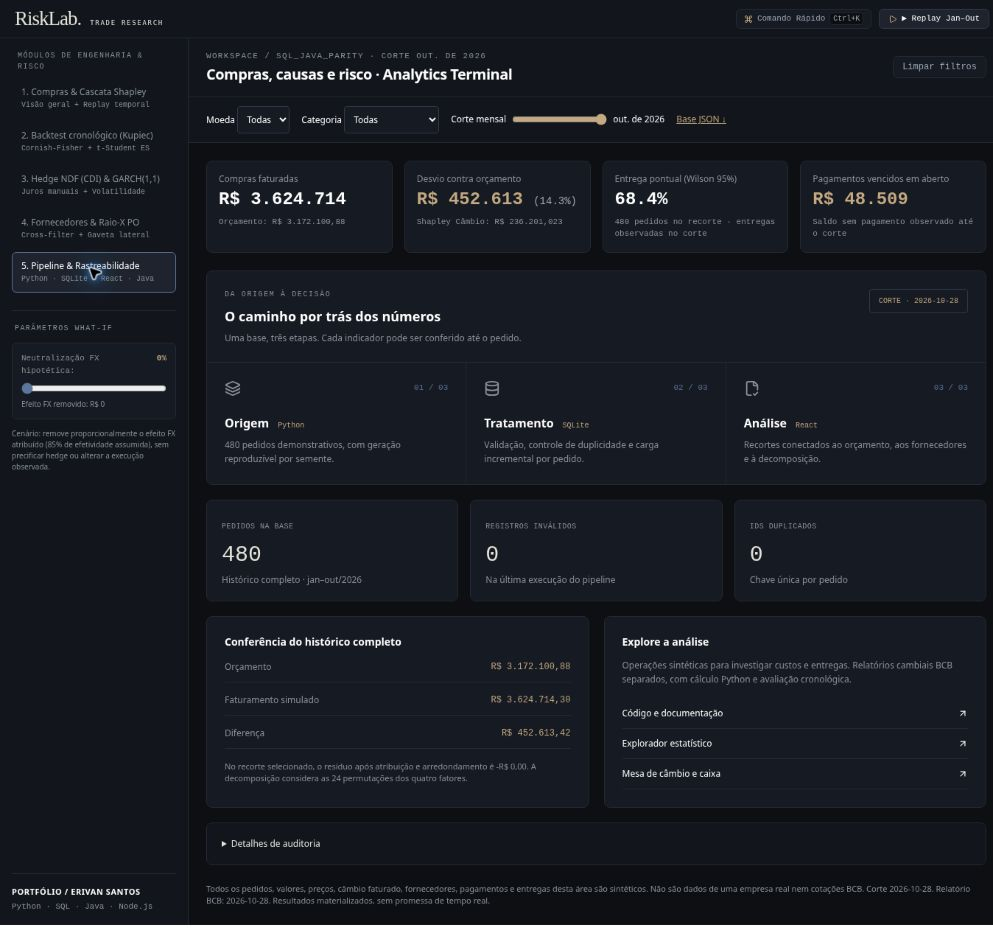
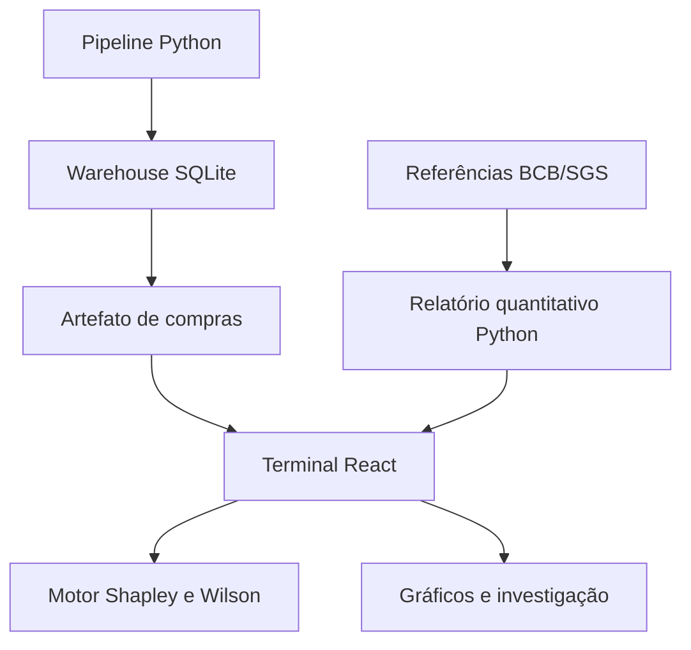

# RiskLab · Trade Research

**Análise de dados aplicada a compras, fornecedores e risco cambial.**

Um terminal interativo para investigar uma pergunta operacional: **por que o custo das compras mudou e onde está a exposição?** O projeto conecta pedidos, orçamento, entregas e pagamentos a uma decomposição de custos e a experimentos quantitativos reproduzíveis.

[**Abrir demonstração pública ↗**](https://risklab-trade-erivan.onrender.com/)



## O que explorar

| Módulo | Pergunta que responde |
| --- | --- |
| **Compras & cascata Shapley** | Quanto do desvio vem de volume, composição, preço e câmbio? |
| **Backtest cronológico** | Como os modelos de VaR se comportam fora da janela de treinamento? |
| **Taxa a termo & volatilidade** | Como as premissas de juros alteram o termo ilustrativo? Como EWMA e GARCH parametrizado se comparam? |
| **Fornecedores & pedidos** | Onde estão os atrasos e quais pedidos explicam os indicadores? |
| **Pipeline & rastreabilidade** | De onde vêm os números, como foram tratados e como conferir sua consistência? |

A interface usa **React, TypeScript, Recharts e Tailwind CSS**, com tema escuro, gráficos animados, contadores interpolados, replay mensal, filtros por moeda e categoria, seleção cruzada por fornecedor, busca por **Ctrl/Cmd + K** e detalhamento lateral dos pedidos. A lista carrega em lotes de 30 registros.

O painel de pipeline apresenta as etapas **origem → tratamento → análise**, indicadores de qualidade e reconciliação. Hash, execução incremental e plano SQL ficam disponíveis em **Detalhes de auditoria**.

## Dados e método

### Operações demonstrativas

- **480 pedidos sintéticos**, 24 SKUs, 8 fornecedores e 4 categorias, de janeiro a outubro de 2026; corte em **28/10/2026**.
- Geração reproduzível por semente, processamento Python e persistência SQLite com validação, carga incremental e hash SHA-256.
- Decomposição Shapley de quatro fatores nas **24 permutações**, recalculada para o recorte selecionado. O arredondamento monetário integra a reconciliação.
- Pontualidade entre pedidos entregues, intervalos de Wilson e investigação de entregas pendentes. O replay respeita o corte de observação de entregas e pagamentos.
- Pagamentos vencidos são analisados separadamente dos atrasos de entrega.

A Aurora Componentes e as operações são fictícias. Valores, câmbio faturado, fornecedores, entregas e pagamentos dessa base **não representam uma empresa real nem cotações BCB**. Shapley atribui uma diferença contábil entre fatores; não demonstra causalidade.

### Experimento quantitativo

O terminal consome um relatório materializado por Python, com referências diárias **BCB/SGS até 28/10/2026**:

- VaR 99% Gaussiano, Cornish–Fisher e t-Student com `df=5`; Expected Shortfall t-Student.
- Avaliação cronológica em 2026, com janela de 252 retornos anteriores a cada previsão.
- Testes de cobertura de Kupiec e independência/cobertura conjunta de Christoffersen, com exceções e fronteiras de treinamento inspecionáveis.
- Comparação EWMA e GARCH(1,1) **parametrizado**, sem alegar ajuste por máxima verossimilhança.
- Taxa a termo ilustrativa com premissas manuais e bases distintas: 63 dias úteis domésticos e 90 dias corridos externos.

O experimento cambial é separado das compras: os filtros de fornecedor/categoria e o replay não alteram silenciosamente o relatório de risco. O filtro de moeda seleciona relatórios disponíveis; quando não há relatório para a seleção, a tela identifica a referência USD usada.

**Limites:** os relatórios do terminal não são um feed em tempo real. VaR não é perda máxima; não rejeitar uma hipótese não aprova um modelo. Cornish–Fisher pode ser instável com assimetria/curtose elevadas. A neutralização FX é um cenário hipotético com efetividade assumida, não uma otimização ou cotação executável de hedge. Não há execução de pagamentos, negociação ou recomendação de investimento.

## Arquitetura



| Camada | Implementação |
| --- | --- |
| Interface | `frontend/src/App.tsx`, `Quant.tsx` e `Pipeline.tsx` |
| Adaptação e recortes | `frontend/src/data.mjs` |
| Motor de compras | `web/purchase-engine.mjs` |
| Pipeline de compras | `analysis/scripts/purchase_pipeline.py` |
| Relatório quantitativo | `analysis/scripts/terminal_quant_report.py` |
| Consultas analíticas | `analysis/sql/purchase_investigation.sql` |
| API e hospedagem | `worker/server.mjs`, `scripts/render-server.mjs` e Render |
| Referência Java | `java-risk/` — implementação e testes próprios |

O navegador consome artefatos materializados; **não consulta um warehouse SQLite hospedado em produção**. O build Vite gera os assets React, que são incorporados ao mesmo handler servido em Node.js e Worker. A referência Java permanece no repositório; o terminal não afirma executá-la para validar seus resultados.

## Executar localmente

Requisito: **Node.js 24** e npm.

```bash
npm ci --include=dev
npm run build
npm run dev -- --port 4173
```

Abra [http://localhost:4173](http://localhost:4173). A raiz abre o terminal React. Após editar o frontend, execute o build e recarregue a página; mudanças no backend também exigem reiniciar o servidor. Não abra o HTML por duplo clique.

### Reproduzir a análise Python

```bash
python -m pip install -r analysis/requirements-tested.txt
python analysis/scripts/purchase_pipeline.py --output web/purchase-research.json --database /tmp/risklab-purchases.sqlite
PYTHONPATH=analysis/src python analysis/scripts/terminal_quant_report.py
```

Depois de renovar os artefatos, execute novamente `npm run build`. Essas rotinas são executadas sob demanda; não há agendamento implícito.

### Verificar

```bash
npm test
npm run validate
PYTHONPATH=analysis/src python -m unittest discover -s analysis/tests -v
```

A última verificação da integração passou em **109 testes JavaScript**, incluindo reconciliação Shapley, filtros, exclusão de pedidos futuros, censura temporal de entregas e recortes vazios. `npm test` também executa o build. A validação do artefato verifica o módulo de produção e sua exportação `fetch`. A análise Python e a referência Java têm verificações próprias configuradas em CI.

Docker está configurado como alternativa: `docker compose up --build web`. Java e Docker não foram executados no ambiente local desta integração.

## Outros ambientes do projeto

| Endereço | Conteúdo |
| --- | --- |
| `/` | Terminal React atual |
| `/editorial.html` | Mesa editorial, caixa, cenários de liquidez e mercados globais |
| `/analytics.html` | Diagnóstico de carteira e backtest, com atualização diária BCB via API |
| `/data-explorer.html` | Distribuições, correlação e qualidade das referências recebidas |
| `/bi.html` | Ambiente anterior de exposição por operações |
| `/performance.html` | Interface anterior de investigação de compras |
| `/research.html` | Pesquisa histórica separada |

As séries externas do TradingView permanecem incorporadas no editorial, com disponibilidade e atraso definidos pelo provedor; não alimentam automaticamente o experimento histórico do terminal. Materiais de Power BI em `analysis/powerbi` são arquivos M/DAX, sem PBIX executado ou validado neste ambiente.

## Documentação e licença

- [Pesquisa e recorte histórico](docs/RESEARCH.md)
- [Decisões de engenharia](docs/DECISIONS.md)
- [Origem e licença dos dados BCB](analysis/DATA_LICENSE.md)
- [Licença MIT do código](LICENSE)

Projeto de portfólio de **Erivan Santos**.
